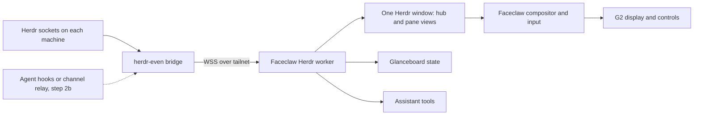

# Herdr app for Faceclaw

## Goal

Build a Faceclaw app that lets the wearer follow and control every Herdr pane on their machines through one Faceclaw window. It should keep the useful parts of `~/herdr-even` (the bridge, transcript adapters, multi-machine status, queue, and subagent views) and use Faceclaw's drawing, voice input, phone editor, assistant tools, Glanceboard, and wake behavior. It uses the Faceclaw firmware already on the glasses and does not require a firmware patch.

Most of the work is in the phone app, but it is not phone-only. The read-only app (step 1) works against the bridge as deployed today. Control needs a bridge patch on every machine: step 2a changes only the bridge's internals and keeps wire protocol 2, and step 2b introduces bridge protocol 3.

The first release is a remote viewer and input client. Creating, moving, splitting, and closing Herdr panes stay outside its scope.

## Prior art and reuse

### Inside Faceclaw

- **Terminal app** (`app/apps/terminal/`, `app/native/g2mirror-client.ts`). It is already a multi-host session hub: connection records stored as JSON under one settings key (`connections.ts`), auto-reconnect with backoff, bells that set attention and wake the glasses, a session-list painter shared with the Glanceboard `terminal` widget (`session-list.ts`), assistant tools, and a headless xterm emulator (`terminal-emulator.ts`) drawn with the terminal font setting at full height. Copy its connection-record, reconnect, wake-routing, and shared-painter patterns, and reuse `TerminalEmulator` for terminal fidelity (step 4) instead of designing a new grid view. The two apps stay separate: Terminal mirrors processes wrapped by g2mirror; Herdr shows Herdr panes. A shell inside a Herdr pane appears only in the Herdr app.
- **Window model.** Terminal opens one window per session and switches between them with the sidebar; T3 Code uses one window. This app uses one window so Back always moves one level up and a wake has one place to land. The cost is that two panes cannot sit in the sidebar at once. Revisit after step 1 if the wearer often switches between two agents.
- **EvenHub host** (`app/apps/evenhub/`) and **`evenhub-extensions`**. The existing herdr-even plugin can already run inside Faceclaw, and the extensions add a taller canvas, font choice, dictated and typed text, assistant tools, and window lifecycle events. A native app is still the choice because only it can provide the Glanceboard widget, attention markers, wake, and Faceclaw's direct frame path. Use the plugin running in Faceclaw's EvenHub host (Developer app → Load app from URL) as the latency baseline in step 1.
- **T3 Code** (`app/apps/t3code/`) for one-window navigation, worker lifecycle, the `boot` + `hasT3BackgroundWork` + `ensureWorkerHost` background pattern, transcript layout, tools, and Glanceboard state.

### Inside Herdr 0.9.5

Herdr's socket API already provides the identities and safe write paths this plan needs. Use them instead of minting bridge tokens with their own lifecycle.

| Need | Herdr field or method | Notes |
| --- | --- | --- |
| Pane instance | `terminal_id`, e.g. `term_65eab92bf072b2` | A bridge pane ID (`default/w1:p1`) names a slot; `terminal_id` names the terminal in it. |
| Agent session | `agent_session` (`{kind: "id", value: <uuid>}`) | The bridge already uses it as the queue identity (`sessions.ts:208`). |
| Unread completion | `completion_seq` | Documented as "completed work, independently of who has viewed it". Unlike `state_change_seq`, it does not move on working or blocked. |
| Prompt revision | `state_change_seq` plus the normalized prompt text | Hash with `terminal_id`. It survives a bridge restart and needs no stored state. |
| Agent message | `agent.prompt` | Sends text and Enter as one ordered submission, honors bracketed-paste mode, and refuses a blocked agent with `agent_blocked` before sending any input. |
| Shell command | `pane.send_input` (`text` plus `keys`) | The method behind `herdr pane run`. |
| Terminal snapshot | `pane.read` with `format: "ansi"` | Feeds `TerminalEmulator` in step 4. |
| Presence | `focused` on each pane | Avoids waking the glasses for the pane the user is typing in on the desktop. |

The bridge's method allowlist (`packages/bridge/src/herdr.ts:4`) says "No create/close/split/focus/rename/move/prompt/start/server.* — ever." This plan deliberately allows `agent.prompt` and adds `pane.send_input`. They are safer than the bridge's own text, 150 ms pause, Enter sequence (`sessions.ts:227`): when the text lands but Enter fails, the queue retries the whole sequence up to `MAX_ATTEMPTS` times and retypes the text. Every other method on the forbidden list stays forbidden.

Herdr's own SSH multi-machine support (`herdr machine`, `herdr --machine`) is not used. The transcript adapters read local files, so each machine still needs its own bridge.

### Other projects

| Project | Relevant design | Use here |
| --- | --- | --- |
| [pawaca/even-better](https://github.com/pawaca/even-better) (MIT) | Herdr agent sessions on G2; transcript first, screen only for permission menus; `POST /permission-response`; QR pairing with a bearer token; compatible with Even's `even-terminal` protocol | Nearly the same design as herdr-even. Borrow QR pairing. Read its protocol before freezing protocol 3 (see Open questions). |
| [wmoto-ai/cc-g2](https://github.com/wmoto-ai/cc-g2) (MIT) | A non-blocking Claude Code `PermissionRequest` hook captures each request; the G2 answer is typed through Herdr or tmux keys; the first answer wins; a `PostToolUse` hook closes the remote card; Herdr `blocked` events cover agents without hooks | Model for structured approvals in step 2b. |
| [Claude Code channel permission relay](https://code.claude.com/docs/en/channels-reference#relay-permission-prompts) | A five-letter `request_id` per approval; a verdict applies only to an open ID; repeated IDs are dropped; the terminal dialog stays open and the first answer wins | The real prompt-bound answer for Claude. It is a research preview, and each session must start with `--dangerously-load-development-channels` and a per-session MCP server. |
| [Happy](https://github.com/slopus/happy), [vibe-kanban](https://github.com/BloopAI/vibe-kanban) | Approvals through the Agent SDK's `canUseTool`, keyed by tool-use ID; stale answers dropped | Not adopted: Happy takes over the agent process, which conflicts with Herdr's real terminal panes. Copy Happy's transcript skip list (`file-history-snapshot`, `change`, `queue-operation`) into transcript cleanup. |
| [Claude Code Remote Control](https://code.claude.com/docs/en/remote-control) | Pushes for required actions; skips them while the user is typing at the terminal | Presence rule for wake (step 3). |
| claude-squad, Claude-Code-Remote | Match a screen string, then type Enter into the terminal | The baseline this plan improves on. |

None of these combine Herdr's multi-agent panes with Faceclaw's native drawing, Glanceboard, wake, and on-glasses review, so a native Faceclaw app remains justified.

## What the wearer sees

1. **Herdr hub.** One launcher entry opens a list with panes needing attention at the top, followed by workspaces across all machines. An urgent pane is one tap away; browsing a multi-pane workspace takes two taps. A workspace with one pane opens it directly. Each row has a stable selection key, status, agent or shell name, and subagent count. Offline machines remain visible with a useful error and a Retry action. A machine is added by scanning a QR code of its bridge URL or by typing the URL in the phone editor; neither requires a rebuild.
2. **Pane view.** Selecting a pane replaces the list inside the same window with a readable conversation view for known agents or a terminal text view for shells and unknown agents. The header shows the machine, workspace, pane, status, and latest tool activity. Scrolling back holds its position as new output arrives; a "jump to live" action returns to the tail. Subagents are read-only views reached from their parent pane. Double-click or the watch Back action returns one level, from subagent to pane to workspace to hub.
3. **Input.** Tap in a pane opens the action that matters now: answer a pending question or permission prompt, otherwise compose a reply. The action menu still provides Enter, Escape, Ctrl+C, arrows, Tab, configured snippets, and exact text from the phone keyboard or watch. Faceclaw's existing voice input supplies dictated text, with a review screen showing the target machine and pane before sending. While an agent works, the user chooses Send now or Queue. The bridge owns and persists queued messages; the app shows them and allows cancellation.
4. **Ambient status.** A Glanceboard widget shows the number of panes needing attention and the top few affected panes. It is a read-only glance, as Faceclaw widgets do not handle selection. A setting may wake the glasses for a new blocked event, using Faceclaw's existing wake-window behavior, unless that pane is focused in Herdr on its machine. The Herdr hub opens with that pane selected. The assistant can list panes, read a pane, send text, send allowed keys, and manage a queue through explicit Herdr tools.

## UX direction

Compare these navigation sketches before building the screen:

| Layout | Route to a blocked pane | Route to a normal pane | Tradeoff |
| --- | --- | --- | --- |
| Machine → workspace → pane | Three taps | Three taps | Clear hierarchy, slow for urgent work |
| One flat pane list | One tap | One tap | Fast access, little workspace context |
| Needs you + workspaces | One tap | One or two taps | Fast urgent access with workspace context |

Use the third layout. Keep the same one-window Back path everywhere.

```text
HERDR                         2 need you
Needs you
  ! mac / api       Claude · approval
  ! linux / site    Codex · question
Workspaces
  > mac / api       3 panes · 1 working
  > linux / site    2 panes · 1 working
  > mac / logs      1 pane
```

- **First run:** show "Scan bridge QR" and "Enter URL", with a short instruction for starting the bridge. After a successful connection, replace the setup screen with the hub. Keep machine management in a menu; it should not occupy a row in the daily list.
- **Selection:** leave the highlight on the same pane or workspace when status updates reorder rows. On returning from a pane, restore the row and scroll position. A newly blocked pane adds an attention marker and moves into "Needs you" without changing the screen the wearer is reading. Track completion reading separately from Herdr's desktop seen state: open a newly completed pane at its first unread entry, and clear its unread marker only after the wearer reaches the end or explicitly chooses Mark read. For screen-only panes, require Mark read because there are no stable transcript entries.
- **Reading:** start at the live tail for an ordinary pane. Swipes move a predictable number of lines. Scrolling away freezes the visible anchor by entry ID and line offset; incoming content raises a small "new output" marker instead of moving the text. Reconnect preserves that anchor and marker. If the bridge no longer has the anchored entry, show "Older output unavailable" and position at the nearest retained entry, with Jump to live offered separately. The header may update tool activity without repainting the body. Use Faceclaw's existing UI font setting rather than adding a second font control.
- **Responding:** show the exact pending prompt first. Structured question choices appear as choices; an unstructured permission prompt leads to explicit key options. Never make a bare tap send `y`, Enter, or a command. Bind the answer to the displayed prompt as described under Answer integrity. A composed message has a review state with target, full text, Send now, Queue when applicable, Edit, and Cancel. After submission, show Sent, Queued, Failed, or "Delivery unknown"; an unknown result does not trigger an automatic retry.
- **Offline:** keep the last pane content visible with an Offline banner and its age. Disable sending while disconnected, preserve an unsent draft on the phone, and restore the same reading position after reconnect. Show each machine's connection state in the hub without covering the other machines' panes.

| Input | Hub or workspace | Pane reader | Review screen |
| --- | --- | --- | --- |
| Swipe up/down | Move selection | Scroll text | Move between actions |
| Tap | Open selected row | Respond to prompt, or compose | Confirm selected action |
| Double tap / watch Back | Previous level or leave Herdr | Previous level | Return to draft or pane |
| Tap then hold | Context menu | Key palette and pane actions | Context menu |

Keep these gestures aligned with Faceclaw's T3 Code app. Do not assign a new command to a gesture already used by the shell.

## Input design

Show the primary action for the selected pane. Keep less common terminal controls in a menu:

| Pane state | Tap opens | First action in the draft | Bridge action, step 2a | Bridge action, step 2b |
| --- | --- | --- | --- | --- |
| Agent has a structured question | Its actual choices | Choose an answer | `keys` after the client-side check | Prompt-bound `answer` |
| Agent is blocked without structured choices | The live prompt and key options | Choose a visible key | `keys` after the client-side check | Prompt-bound `answer`, or a structured approval where available |
| Agent is working | Message composer | Queue until idle; Send now is explicit | `text` with `queue`; Send now is `text` with `enter` | `prompt` with `queue` or immediate |
| Agent is idle or done | Message composer | Send message | `text` with `enter`, which the bridge sends as `agent.prompt` | `prompt` |
| Shell or other terminal | Command composer | Run command | `text` with `enter` | `run` through `pane.send_input` |

- **One draft across devices.** Voice, phone keyboard, and watch keyboard fill the same draft. When composing starts, capture the machine, the pane's `terminal_id`, and its `agent_session`; a pending answer also captures its prompt revision. Switching panes never silently retargets a draft. Show the machine and pane above it and again at confirmation. Preserve an unsent draft through Back, a brief disconnect, and an interrupted voice attempt. After reconnect, revalidate its target before enabling Send; if the terminal or agent session changed, keep the text and ask the wearer to choose a new target. Phone text can be edited before sending. An incoming `text-input` event fills the draft and never types into Herdr; when it carries `submit: true`, it opens the review screen instead of sending.
- **Three distinct send actions.** "Send message" submits an agent turn, "Run command" submits a shell line, and "Type without Enter" inserts literal text for an interactive terminal. The last action lives in the key menu. These actions have separate types and handlers so a raw paste cannot accidentally run a command. For a working agent, Queue is selected first; the user still confirms it. Queue is absent for shells, blocked agents, and read-only subagent views. Agents differ in what typed input does mid-turn (Claude Code accepts it during the turn), so label Send now by its effect for the pane's agent and check each supported agent during step 2a.
- **Fast terminal keys.** The pane menu has Enter, Esc, Ctrl+C, Tab, arrows, snippets, and "Keys mode". Keys mode is an explicit secondary mode for interactive terminal apps: a visible `KEYS → machine / pane` banner stays on screen; ring scroll sends Up/Down, watch swipes send four arrows, and tap sends Enter. Double tap leaves Keys mode and restores normal scrolling. Leaving the pane, losing foreground, sleeping, or seeing a new blocked prompt also exits it. The ring has no left/right swipe, so those keys remain in the palette. Outside Keys mode, watch directions keep Faceclaw's normal navigation meanings. Do not enable Keys mode for read-only subagents.
- **Outcomes.** A selected question choice or key sends once and shows its result. A message or command leaves the draft only after the bridge acknowledges it; on a timeout, keep the draft with "Delivery unknown" and offer an explicit Check output action before Resend. Show queued items in the pane, with Remove beside each; when the bridge is already delivering an item, Remove reports "Too late" instead of failing silently. Give every queued item a durable outcome: pending, accepted by Herdr, canceled, or undelivered with a reason. On reconnect, show undelivered items with their original text and a deliberate retry action; an item disappearing from the pending list never implies delivery. If the bridge rejects a queue because the agent's status changed, keep the draft and offer Send now.
- **Host input methods.** Use `agent.prompt` for agent messages, `pane.send_input` for shell commands, `pane.send_text` for literal text without Enter, and `pane.send_keys` for keys. In step 2a the bridge routes `text` with `enter` on an agent pane, and queued delivery, through `agent.prompt`. Text to a blocked agent is then refused with `agent_blocked`, so blocked prompts are answered only with keys until step 2b. Before relying on `pane.send_input`, probe it on a shell and an interactive terminal app to confirm the Enter is not read as part of a paste. An acknowledgement means Herdr accepted the input, not that the command or agent turn finished. Herdr's documentation also warns that a timeout does not prove a prompt was not delivered, which matches the no-automatic-retry rule.
- **Answer integrity.** Herdr's key API has no compare-and-send, so a prompt can change between any check and the keystrokes. Never label a keystroke answer as a guaranteed approval.
  - Step 2a: the app sends an answer's `keys` only if the pane's `stateSeq` and the latest `prompt` text it holds still match what the wearer saw. This check runs on the phone and is best effort.
  - Step 2b: a separate `answer` operation carries the `terminal_id` and the prompt revision (a hash of `terminal_id`, `state_change_seq`, and the normalized prompt text). The bridge re-reads the pane immediately before sending and rejects a changed revision. Ordinary new agent messages remain refused while the agent is blocked. Raw keys and terminal writes also carry the `terminal_id`, and the bridge rejects a request whose pane ID now holds another terminal.
  - Structured approvals replace keystroke answers where an agent supports them. Prototype cc-g2's pattern (a non-blocking `PermissionRequest` hook that posts `tool_name` and input to the bridge, the answer typed as keys, and a `PostToolUse` hook that reconciles a local answer) and Claude Code's channel permission relay (a true request-ID binding) on one Claude pane. Pick based on setup cost. Agents without hooks keep keystroke answers and Herdr's blocked status. No change to Herdr is required.
- **Queue receipts.** Keep the bridge's session-aware queue. Add a bounded, persistent outcome ledger keyed by queue item ID so accepted, canceled, and discarded outcomes, including a discard reason, can be fetched after reconnect. Today the bridge sends `queue` messages only for the pane open on that socket (`server.ts`), so publish queue counts and undelivered outcomes for every pane on the machine stream; otherwise the hub and widget cannot show them.

## Architecture



- Keep `~/herdr-even/packages/bridge` as the host-side service. Protocol 2 is the wire contract through step 2a; protocol 3 arrives in step 2b. Reuse its session discovery, Claude/Codex/other transcript adapters, screen fallback, queued delivery, and Tailscale owner check. The EvenHub plugin's SDK rendering, 20-row pagination, baked machine allowlist, and separate Deepgram client are not needed in a built-in Faceclaw app.
- Put the Faceclaw client under `app/apps/herdr/`: a small validated protocol boundary, connection manager, normalized pane model, window renderer, and `index.ts` app definition. Register it in `app/apps/all-apps.ts`, and add a `herdr` entry to `GlanceWidgetId` (`app/apps/glanceboard/widget.ts`). Pin a copy of the wire contract in this repo, with fixture tests against real bridge messages; do not make the APK depend on a sibling checkout. Use the T3 Code and Terminal workers as integration examples, not as code to copy.
- Persist machine records in Faceclaw settings as one JSON value, as Terminal's `connections.ts` does. Give each record a local stable ID, label, HTTPS base URL, enabled flag, and connection state. Deduplicate records that report the same `hello.machine`, so a host added under two URLs does not show every pane twice. A pane identity is `(machine ID, bridge pane ID, terminal_id)`; pane IDs alone are only unique on one machine, and only `terminal_id` distinguishes a replaced terminal. Step 1 uses protocol 2's `id` until protocol 3 adds `terminal_id`.
- `/health` needs no authentication and `/ws` returns 403 to an unknown Tailscale identity, so "unreachable" and "forbidden" can already be told apart. Faceclaw's socket is OkHttp (`FaceclawWebSocket.kt`) and reports `t.toString()`, which normally includes the refused upgrade's HTTP status. Confirm that in the step 1 smoke test, and add a diagnostic endpoint to the bridge only if it does not.
- Keep one persistent WebSocket per enabled machine, reconnecting with Terminal's backoff. Each carries that machine's `panes` stream; only the currently displayed pane has an `open` view subscription on its machine's socket. Close the old subscription when switching panes or returning to the hub, and reopen the selected pane after reconnecting. An assistant read of another pane can use a short-lived socket so it does not change the visible pane. Keep bounded per-pane scroll anchors across pane switches and reconnects; only an explicit Jump to live clears one. Coalesce stream-driven redraws and never submit frames while the Herdr window is hidden.
- Keep the worker alive in the background only while a Herdr window, the widget, or an enabled attention watch needs it, using T3 Code's `boot` hook with a `hasHerdrBackgroundWork` check and `ensureWorkerHost`.
- Store only bounded UI state on the phone, including the per-pane read markers. Keep bridge-owned queues on the bridge. Validate incoming JSON once at the protocol boundary, treat stale replies as belonging to the old view, and never retry a timed-out write automatically because the bridge may have executed it already.
- Use Faceclaw's native socket, worker window messages, drawing and font utilities, text editor, QR scanner (`app/native/qr-scan.ts`), and configured speech-to-text path. The renderer should use the available viewport, including full height when the shell grants it, rather than an EvenHub 576×288 page.

## Delivery sequence

### 1. Ship a read-only app

Start with a short smoke test: a tiny Faceclaw worker connects to one deployed bridge over the phone's tailnet and checks TLS, the Tailscale identity header, `/health`, `hello`, pane updates, disconnect, reconnect, and the failure text for a rejected identity. herdr-even's spec already confirmed the tailnet path and identity header from an Android WebView, so this is a check, not a research phase.

Then add machine setup (QR scan and typed URL), the hub, workspace and pane lists, conversation rendering, terminal text fallback, scrollback, and subagent drill-down. Port the plugin's pure urgency and grouping rules and transcript cleanup, plus Happy's transcript skip list. Track unread completions with protocol 2's `stateSeq`, as the plugin does; switch to `completion_seq` in protocol 3. Use Faceclaw's own fonts, scroll controls, and redraw scheduling; keep incoming stream data independent from selection and scroll state. Show a visible connection and protocol error rather than an empty list. The bridge gains a `pair` command that prints its URL as a QR code; any QR code of the URL also works, so this needs no wire change.

**Gate:** on glasses, a blocked pane opens in one tap from the hub, a normal pane in at most two, and Back restores the previous selection. The wearer can switch between panes on two machines within one window, read recent transcripts and a plain shell pane, and scroll back without being thrown to live by tool updates or reconnect. A completed pane keeps its unread marker until its output is read or marked read. One offline machine does not hide the other. Blocked-to-display and scroll latency are no worse than the herdr-even plugin running in Faceclaw's EvenHub host.

### 2a. Add control on protocol 2

Wire the shared draft, typed and dictated text, review, status-aware primary action, queue and unqueue, structured question choices answered with keys, snippets, and the key palette. Test Keys mode on the watch and ring without changing the normal reader gestures. Patch the bridge without changing the wire protocol: allow `agent.prompt`, and route `text` with `enter` on an agent pane, and queued delivery, through it. This closes the retype-on-retry bug and makes Herdr refuse new messages to a blocked agent.

**Gate:** keys, phone/watch text, voice text, shell commands, and queued follow-ups reach the intended pane once. A blocked question can be answered with its keys, and a message sent to a blocked agent is refused with `agent_blocked` rather than typed. An answer whose prompt changed on the phone's latest view is not sent. Every draft names a fixed target. A queued message survives a phone disconnect. A timed-out write keeps its draft and is shown as uncertain rather than silently repeated. Keys mode shows its active target and exits on Back, sleep, focus loss, and a new blocked prompt. Release after this gate.

### 2b. Add bridge protocol 3 and structured approvals

Add `terminal_id`, `agent_session`, `completion_seq`, and `focused` to each pane summary. Add typed `prompt`, `run`, `type`, and `answer` operations, each carrying `terminal_id`; derive prompt revisions as described under Answer integrity. Allow `pane.send_input` after the paste probe. Add the queue outcome ledger and per-pane queue summaries on the machine stream. Prototype structured approvals (cc-g2-style hooks and Claude Code's channel relay) on one Claude pane and adopt one. Consider Claude Code's `Notification` hook with `notification_type: "permission_prompt"` as a second blocked signal beside Herdr's status. Keep protocol 2 working for old clients, or give them a clear mismatch.

**Gate:** a typed answer can be sent while the agent is blocked; a changed prompt or a replaced terminal detected by the bridge's pre-send check is rejected before typing. A discarded queued message returns after reconnect with its text and reason, and undelivered counts appear in the hub for panes that are not open. For the adopted structured-approval path, an approval made at the desktop first clears the card on the glasses, and a late answer from the glasses has no effect.

### 3. Add Faceclaw-specific conveniences

Add the Glanceboard widget, attention markers and optional wake, assistant tools, and fast navigation from the watch and voice assistant. Record the last notified pane/session/block event. On reconnect, refresh counts but do not wake for an event already notified; if event identity cannot be determined, treat the first snapshot as a baseline. Coalesce simultaneous new blocked events into one wake, choose one pane deterministically, and hold that selection until the wearer navigates. Do not wake for a pane that is `focused` in Herdr on its machine. The shell already ignores `wake-window` unless the screen is off (`worker-window.ts:64`), so a wake never steals focus while the glasses are in use. Offer a screen-text toggle beside conversation mode for agent panes so the wearer can inspect what the terminal itself shows when a transcript adapter misses context.

**Gate:** a new blocked state reaches the widget's snapshot within about one second while another app is foreground, and appears when the board is shown; the optional wake opens the Herdr hub with one affected pane selected only when the glasses are asleep and the pane is not focused on the desktop; reconnecting or receiving several blocked updates does not repeat the wake or change that selection; assistant tools resolve the exact machine and pane before any write.

### 4. Improve terminal fidelity after device measurements

Measure frame latency and legibility on G2 before adding richer terminal drawing. If text fallback is insufficient, add a versioned bridge subscription that forwards `pane.read` with `format: "ansi"` and `source: "visible"`, and render it with the Terminal app's `TerminalEmulator` and terminal font setting, adding zoom and horizontal pan for panes wider than the glasses grid. Do not resize the host's pane. Keep the transcript view as the default for coding agents.

**Gate:** the terminal view preserves line order and cursor location on a real shell, scrolls reliably, and meets the existing plugin's roughly 200 ms interaction target without flooding BLE frames.

## Verification and release

- Use the existing bridge's mock and real-socket tests to check protocol versioning, multi-machine identity, reconnect, delayed replies, queue delivery/discard receipts, `agent_blocked` refusal, a replaced terminal behind a reused pane ID, prompt changes after review, and a pane whose agent session changes while a draft is open. Test the Faceclaw UI against a deterministic mock bridge with blocked, working, finished, shell, and offline panes.
- Verify on an Android phone and G2: launcher entry and in-window navigation, both display sizes, ring and watch gestures, voice and phone text, QR setup, sleeping and waking, two live machines, and a bridge restart. Measure blocked-to-display, input-to-echo, and scroll latency against the targets in `~/herdr-even/spec.md` and the EvenHub-host baseline.
- Register the launcher entry when the read-only gate passes, and release after the step 2a gate. Step 2b ships as a versioned bridge release plus an app update; a phone on the new app still works against a protocol 2 bridge with the step 2a feature set.

## Open questions

- **`even-terminal` protocol.** even-better and Even's official `even-terminal` share a protocol. If Faceclaw spoke it, either could serve as a backend. Default: keep herdr-even's protocol, which this plan already depends on, but read even-better's before freezing protocol 3.
- **Structured approvals.** Hooks or channel relay is decided by the step 2b prototype. Not yet verified: whether Claude Code's terminal dialog stays visible while a blocking `PermissionRequest` hook waits, and the details of Codex's app-server approval requests.
- **Window model.** Revisit one window versus one window per pane after step 1.

## Source points

- Existing Herdr behavior and wire messages: `~/herdr-even/spec.md`, `packages/protocol/src/index.ts`, `packages/bridge/src/server.ts`, `packages/bridge/src/queue.ts`, `packages/bridge/src/herdr.ts` (method allowlist), `packages/bridge/src/sessions.ts` (send path and queue identity), and `packages/plugin/src/model.ts`.
- Herdr API: `herdr api schema --output <file>` (protocol 22) and `herdr --skill` for `agent.prompt`, `agent_blocked`, and seen-state semantics.
- Faceclaw examples: `app/apps/t3code/` for one-window navigation, worker lifecycle, background boot, transcript layout, tools, and Glanceboard state; `app/apps/terminal/` for connection records, reconnect, wake on bell, the shared hub/widget painter, and `TerminalEmulator`; `app/apps/evenhub/` and `evenhub-extensions/` for the plugin baseline; `app/ui/shell/worker-window.ts` for voice, `text-input`, attention, wake, and tools; `app/native/socket.ts` and `FaceclawWebSocket.kt` for the socket; `app/native/qr-scan.ts` for QR setup; `app/apps/all-apps.ts` for registration.
- Prior art: [even-better](https://github.com/pawaca/even-better), [cc-g2](https://github.com/wmoto-ai/cc-g2), [Claude Code channels reference](https://code.claude.com/docs/en/channels-reference), [Claude Code hooks](https://code.claude.com/docs/en/hooks), [Happy](https://github.com/slopus/happy), [Herdr socket API](https://herdr.dev/docs/socket-api/).
